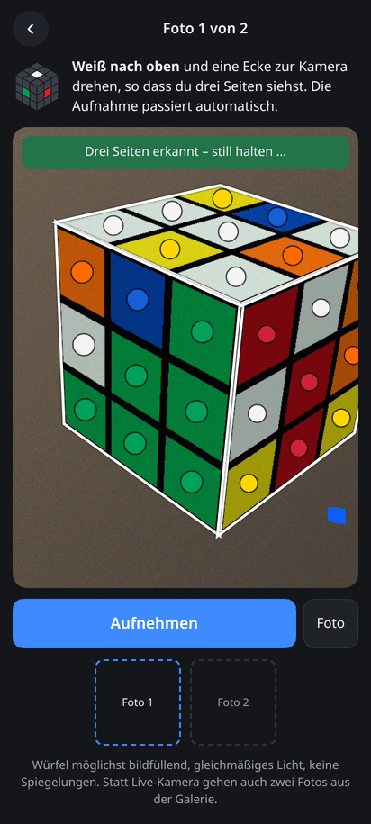
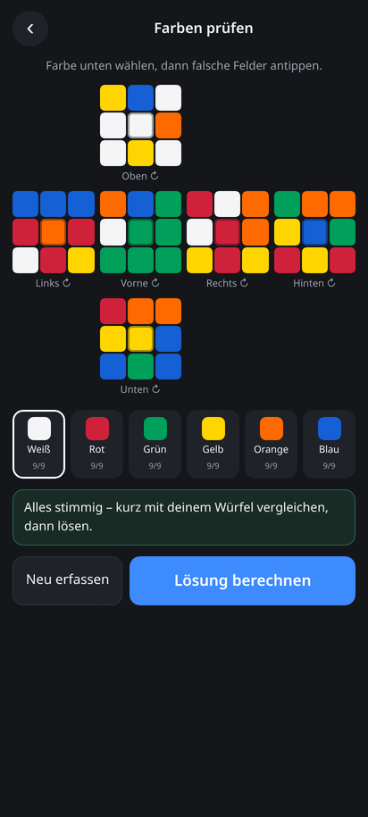
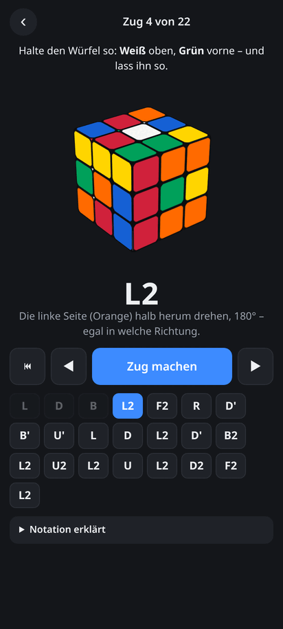

# Rubik's Cube Solver

[](https://github.com/michaelkrisper/rubik/actions/workflows/ci.yml)
[](https://github.com/michaelkrisper/rubik/releases)
[](LICENSE)
[](https://michaelkrisper.github.io/rubik/)
[](.nvmrc)
[](https://biomejs.dev)

Photograph a scrambled 3x3x3 Rubik's Cube with your phone and solve it move by
move. Two angled photos are enough: the app finds the cube in perspective,
computes a solution of at most 22 moves and shows every move on an animated 3D
cube. Runs entirely in the browser on Android and iPhone, nothing is uploaded.

**Live demo: [michaelkrisper.github.io/rubik](https://michaelkrisper.github.io/rubik/)**

The user interface is in German.

<p align="center">
  
  
  
</p>

## Features

- **Two photos instead of six**: one corner towards the camera (white on top),
  then flip the cube (yellow on top). The live view outlines the detected faces
  and captures automatically once three faces are stable.
- **Perspective detection without libraries**: finds stickers, fits a 3x3 grid
  per face, rectifies it and samples the colours, including stickerless cubes
  with narrow gaps.
- **Asks rather than guesses**: uncertain captures are rejected with a hint on
  what to improve ("move closer", "more from above").
- **Review and correct**: cube net with every sticker, a count per colour,
  impossible corners and edges are highlighted. If the cube cannot be solved,
  the app swaps the two least certain stickers itself and marks them.
- **Short solutions**: Kociemba two-phase algorithm, at most 22 moves
  (usually 19-22).
- **Guided on a 3D cube**: every move is animated and explained in words, with
  step forward/back and autoplay. The screen stays awake meanwhile.
- **Alternatives**: scan face by face, or enter the colours by hand.
- **Installable, offline and private**: no server, no tracking, photos never
  leave the device.

## Usage

1. Choose **Würfel fotografieren** (photograph cube) and allow the camera.
2. **Photo 1**: white on top, one corner towards the camera so that three
   faces are visible. The app captures as soon as it recognises all three.
3. **Photo 2**: flip the cube, yellow on top. The app tells you which colours
   belong on the left and right.
4. **Review**: compare the net with the real cube and tap wrong stickers (pick
   the correct colour below first).
5. **Solve**: hold the cube as shown (white on top, green in front) and repeat
   each move.

Two photos from the gallery work as well. The app can be installed via _Add to
Home Screen_.

### Why two photos?

A single photo shows at most three faces. One corner and three edges are then
completely hidden, and nine more pieces show only one colour. Many different
cubes match such a photo, but a solver needs the exact state.

## How it works

| File                                         | Responsibility                                                        |
| -------------------------------------------- | --------------------------------------------------------------------- |
| [`js/detect.js`](js/detect.js)               | Cube detection in one photo, merging two photos                       |
| [`js/snap.js`](js/snap.js)                   | Camera UI: live detection, automatic capture, hints                   |
| [`js/detect-worker.js`](js/detect-worker.js) | Detection in a Web Worker                                             |
| [`js/color.js`](js/color.js)                 | Colour sampling, classification in CIELAB, repair                     |
| [`js/cube.js`](js/cube.js)                   | Facelet model, moves, validity check                                  |
| [`js/view3d.js`](js/view3d.js)               | 3D cube built from CSS transforms, move animation                     |
| [`js/app.js`](js/app.js)                     | Flow, face-by-face scan, review screen, solution view                 |
| [`worker.js`](worker.js)                     | Kociemba solver ([cubejs](https://github.com/ldez/cubejs), `vendor/`) |

**Detection** (`detectCube`): Sobel edges plus dark gaps form a boundary mask.
Its connected components are approximated as quadrilaterals (convex hull,
maximum-area quadrilateral) and kept as stickers if shape, colour and size fit.
Stickers with the same orientation and integer spacing form the grid of a
face, which yields a homography. The three faces are placed jointly: no
overlap, one shared corner, matching edges. Weakly detected faces get the
corner points of their neighbours as extra control points. If the cube is
small in the frame, its region is analysed a second time at full resolution.

**Assignment** (`assemble`): which face is which follows from the centre
colours, the handedness of the corner (read clockwise) and the "white on top"
or "yellow on top" instruction; the white centre serves as white balance. The
position of every sticker follows from the shared corner and edges.

**Colours** (`classify`): the six centres are the seeds; every sticker goes to
the nearest colour with exactly nine stickers per colour, then pairwise swaps
improve the result. This separates red/orange and white/yellow more robustly
than fixed thresholds.

## Development

Requirements: Node.js 24 or newer (CI uses the version in
[`.nvmrc`](.nvmrc)) and Google Chrome for the browser test. There is no
build step; the files in the repository are the app.

```sh
npm ci
npm run serve           # http://localhost:8080
```

| Command                 |                                                                |
| ----------------------- | -------------------------------------------------------------- |
| `npm run lint`          | Biome: formatting and lint                                     |
| `npm run lint:fix`      | the same, applying fixes                                       |
| `npm test`              | unit tests (`node:test`)                                       |
| `npm run test:coverage` | unit tests with minimum coverage for model, colours, detection |
| `npm run test:e2e`      | end-to-end test in headless Chrome                             |
| `npm run check`         | lint and unit tests                                            |

### Tests

- **Model and solver** (`test/cube.test.js`): moves against cubejs, validity,
  solutions really solve the cube.
- **Colours** (`test/color.test.js`): sampling, classification of noisy
  photos, repair.
- **Detection** (`test/detect.test.js`): [`test/render.js`](test/render.js)
  renders scrambled cubes in perspective with lighting, colour cast, noise and
  distractors, also stickerless and small in high resolution. Detection must
  return the exact state; a wrong detection fails the test, "not detected" is
  allowed within limits.
- **End-to-end** (`scripts/e2e.mjs`): a rendered photo as fake camera in Chrome
  (the automatic capture must trigger), the second one via the gallery picker,
  plus the face-by-face scan, the solver and a check of the 3D animation
  against the model. Screenshots go to `$TMPDIR/rubik-shots`.

CI ([`.github/workflows/ci.yml`](.github/workflows/ci.yml)) runs all of this on
every push and pull request and deploys `main` to GitHub Pages only after
everything passed.
Every merge to `main` is tagged with the next patch version; bundled releases
with release notes come from the Release workflow (see
[CONTRIBUTING](CONTRIBUTING.md#versions-and-releases)).

## Limitations

- Two-photo detection assumes the standard colour scheme (white opposite
  yellow, green opposite blue, red opposite orange). Use the face-by-face scan
  for other schemes.
- Faces photographed at a very flat angle, strong reflections and cubes that
  fill only a small part of the frame are rejected.

## Contributing

Issues and pull requests are welcome; see [CONTRIBUTING.md](CONTRIBUTING.md) for
the workflow, versions and releases.

## License

[MIT](LICENSE). The solver comes from [cubejs](https://github.com/ldez/cubejs),
MIT, (c) Petri Lehtinen, Ludovic Fernandez
([`vendor/cubejs/LICENSE`](vendor/cubejs/LICENSE)).
