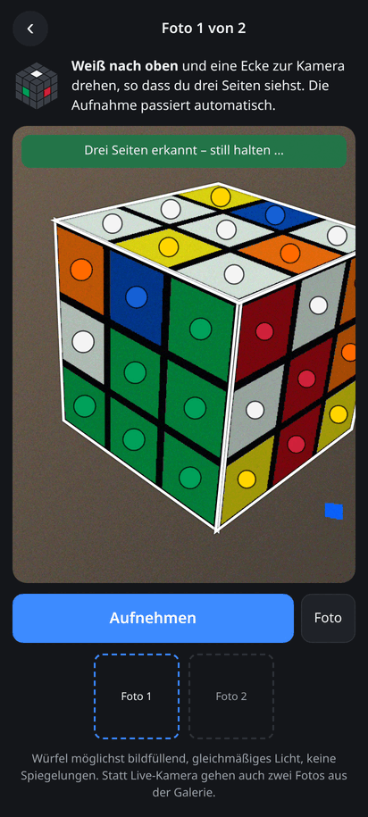
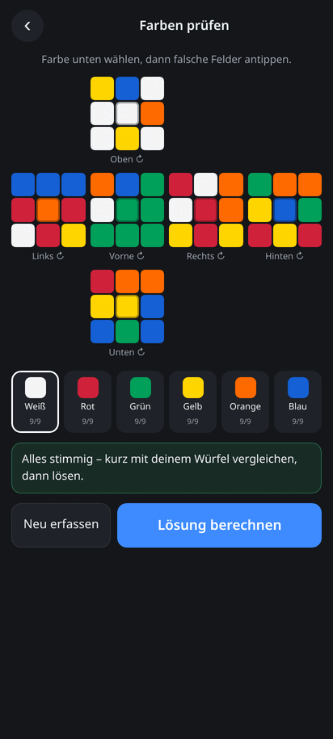
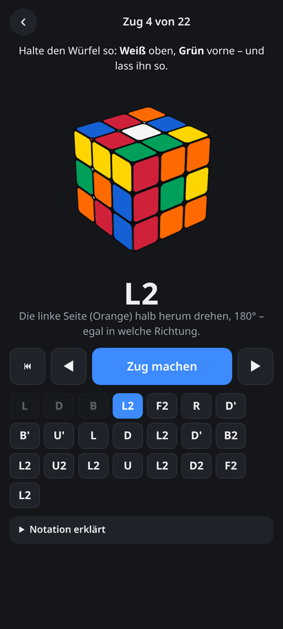

# Würfel-Löser

[](https://github.com/michaelkrisper/rubik/actions/workflows/ci.yml)
[](LICENSE)
[](https://biomejs.dev)
[](https://michaelkrisper.github.io/rubik/)

Einen verdrehten Rubik's Cube (3×3×3) mit dem Handy fotografieren und Zug für
Zug lösen. Zwei Fotos von schräg genügen; die App erkennt den Würfel in der
Perspektive selbst, berechnet eine Lösung mit höchstens 22 Zügen und zeigt
jeden Zug an einem animierten 3D-Würfel. Läuft im Browser auf Android und
iPhone, ohne Upload.

**→ [michaelkrisper.github.io/rubik](https://michaelkrisper.github.io/rubik/)**

<p align="center">
  
  
  
</p>

## Funktionen

- **Zwei Fotos statt sechs**: eine Ecke zur Kamera (Weiß oben), dann umdrehen
  (Gelb oben). Die Live-Ansicht zeichnet die erkannten Seiten ein und löst
  automatisch aus, sobald drei Seiten stabil erkannt sind.
- **Perspektivische Erkennung ohne Bibliothek**: Sticker finden, je Seite ein
  3×3-Gitter einpassen, perspektivisch entzerren, Farben abtasten, auch bei
  stickerlosen Würfeln mit schmalen Fugen.
- **Lieber nachfragen als raten**: unsichere Aufnahmen werden verworfen, mit
  einem Hinweis, was besser geht („näher ran“, „mehr von oben“).
- **Prüfen und korrigieren**: Würfelnetz mit allen Feldern, Zählung je Farbe,
  unmögliche Ecken und Kanten werden markiert. Geht der Würfel nicht auf,
  tauscht die App selbst die zwei unsichersten Felder und markiert sie.
- **Optimale Lösung in wenigen Zügen**: Kociemba-Zwei-Phasen-Algorithmus,
  höchstens 22 Züge (meist 19–22).
- **Anleitung am 3D-Würfel**: jeder Zug animiert und in Worten erklärt
  („vordere Spalte wandert nach oben“), vor- und zurückspulen, abspielen.
  Der Bildschirm bleibt dabei an.
- **Alternativen**: Seite für Seite frontal scannen oder Farben von Hand eingeben.
- **Installierbar und offline**, **privat**: kein Server, kein Tracking, die
  Fotos verlassen das Gerät nicht.

## Benutzung

1. **Würfel fotografieren** wählen und die Kamera erlauben.
2. **Foto 1**: Weiß nach oben, eine Ecke zur Kamera, so dass drei Seiten zu
   sehen sind. Die App nimmt auf, sobald sie alle drei sicher erkennt.
3. **Foto 2**: Würfel umdrehen, Gelb nach oben. Die App sagt, welche Farben
   links und rechts sein sollen.
4. **Prüfen**: Netz mit dem echten Würfel vergleichen, falsche Felder antippen
   (vorher unten die richtige Farbe wählen).
5. **Lösen**: Würfel so halten wie angezeigt (Weiß oben, Grün vorne) und jeden
   Zug nachdrehen.

Statt der Live-Kamera gehen auch zwei Fotos aus der Galerie. Über *Zum
Startbildschirm hinzufügen* lässt sich die App installieren.

### Warum zwei Fotos?

Auf einem Foto sind höchstens drei Seiten zu sehen. Eine Ecke und drei Kanten
sind dann komplett verdeckt, von neun weiteren Teilen sieht man nur eine Farbe.
Dazu passen sehr viele verschiedene Würfel; ein Löser braucht aber den genauen
Zustand.

## Wie es funktioniert

| Datei | Aufgabe |
|---|---|
| [`js/detect.js`](js/detect.js) | Würfelerkennung in einem Foto, Zusammenführen zweier Fotos |
| [`js/snap.js`](js/snap.js) | Kamera-Oberfläche: Live-Erkennung, Auto-Aufnahme, Hinweise |
| [`js/detect-worker.js`](js/detect-worker.js) | Erkennung im Web Worker |
| [`js/color.js`](js/color.js) | Farbabtastung, Klassifikation in CIELAB, Reparatur |
| [`js/cube.js`](js/cube.js) | Facelet-Modell, Züge, Gültigkeitsprüfung |
| [`js/view3d.js`](js/view3d.js) | 3D-Würfel aus CSS-Transforms, Zug-Animation |
| [`js/app.js`](js/app.js) | Ablauf, Seiten-Scan, Prüfansicht, Lösungsanzeige |
| [`worker.js`](worker.js) | Kociemba-Löser ([cubejs](https://github.com/ldez/cubejs), in `vendor/`) |

**Erkennung** (`detectCube`): Kanten nach Sobel plus dunkle Fugen ergeben eine
Grenzmaske; deren Zusammenhangskomponenten werden als Viereck angenähert
(konvexe Hülle, flächenmaximales Viereck) und als Sticker behalten, wenn Form,
Farbe und Größe passen. Sticker mit gleicher Ausrichtung und ganzzahligem
Abstand bilden das Gitter einer Seite, daraus folgt eine Homographie. Die drei
Seiten werden gemeinsam platziert: keine Überlappung, eine gemeinsame Ecke,
übereinstimmende Kanten. Schwach erkannte Seiten bekommen die Eckpunkte der
Nachbarseiten als zusätzliche Passpunkte. Ist der Würfel klein im Bild, wird
sein Ausschnitt in voller Auflösung ein zweites Mal ausgewertet.

**Zuordnung** (`assemble`): Welche Seite welche ist, ergibt sich aus den
Mittelfarben, der Händigkeit der Ecke (im Uhrzeigersinn gelesen) und der
Vorgabe „Weiß oben“ bzw. „Gelb oben“; die weiße Mitte dient als Weißabgleich.
Die Lage jedes Felds folgt aus der gemeinsamen Ecke und den geteilten Kanten.

**Farben** (`classify`): Die sechs Mittelsteine sind die Startwerte; jedes Feld
geht an die nächste Farbe, mit genau neun Feldern je Farbe, danach verbessern
paarweise Tausche das Ergebnis. Das trennt Rot/Orange und Weiß/Gelb robuster
als feste Schwellwerte.

## Entwicklung

Voraussetzungen: Node.js 24, Google Chrome für den Browsertest. Es gibt keinen
Build-Schritt; die Dateien im Repository sind die App.

```sh
npm ci
npm run serve           # http://localhost:8080
```

| Befehl | |
|---|---|
| `npm run lint` | Biome: Formatierung und Lint |
| `npm run lint:fix` | dasselbe, mit Korrekturen |
| `npm test` | Unit-Tests (`node:test`) |
| `npm run test:coverage` | Unit-Tests mit Mindestabdeckung für Modell, Farben und Erkennung |
| `npm run test:e2e` | Ende-zu-Ende im headless Chrome |
| `npm run check` | Lint und Unit-Tests |

### Tests

- **Modell und Löser** (`test/cube.test.js`): Züge gegen cubejs, Gültigkeit,
  Lösungen lösen den Würfel wirklich.
- **Farben** (`test/color.test.js`): Abtastung, Klassifikation verrauschter
  Fotos, Reparatur.
- **Erkennung** (`test/detect.test.js`): [`test/render.js`](test/render.js)
  rendert verwürfelte Würfel perspektivisch, mit Licht, Farbstich, Rauschen
  und Störobjekten, auch stickerlos und klein in hoher Auflösung. Die Erkennung
  muss daraus exakt den Zustand zurückliefern; eine falsche Erkennung lässt den
  Test fehlschlagen, ein „nicht erkannt“ ist in Grenzen erlaubt.
- **Ende-zu-Ende** (`scripts/e2e.mjs`): ein gerendertes Foto als Fake-Kamera
  in Chrome (die Auto-Aufnahme muss auslösen), das zweite über die
  Galerie-Auswahl, dazu der Seiten-Scan, der Löser und ein Abgleich der
  3D-Animation mit dem Modell. Screenshots landen in `$TMPDIR/rubik-shots`.

Die CI ([`.github/workflows/ci.yml`](.github/workflows/ci.yml)) führt alles bei
jedem Push und Pull Request aus und veröffentlicht `main` danach auf GitHub
Pages.

## Grenzen

- Die Erkennung aus zwei Fotos setzt das übliche Farbschema voraus (Weiß
  gegenüber Gelb, Grün gegenüber Blau, Rot gegenüber Orange). Für andere
  Schemata gibt es den Seiten-Scan.
- Sehr flach fotografierte Seiten, starke Spiegelungen und Würfel, die nur
  einen kleinen Teil des Bildes füllen, werden abgelehnt.

## Lizenz

[MIT](LICENSE). Der Löser stammt aus [cubejs](https://github.com/ldez/cubejs),
MIT, © Petri Lehtinen, Ludovic Fernandez ([`vendor/cubejs/LICENSE`](vendor/cubejs/LICENSE)).
